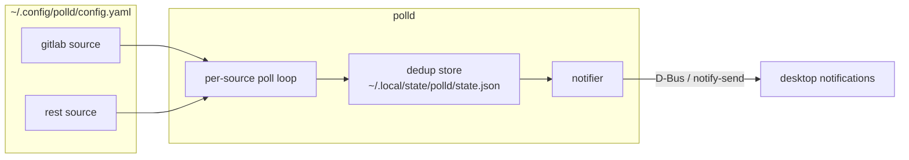

# polld

A small, well-tested Linux daemon that polls HTTP services and turns changes
into desktop notifications. Runs as a **systemd user service** on Ubuntu
24.04+ and is a single static binary — no runtime to drift between releases.



## Features

- **GitLab adapter** (`type: gitlab`) — merge-request activity (new, updated,
  merged) and project events (pushes, issues, comments, …), globally or per
  project, with state/action filters.
- **Generic REST adapter** (`type: rest`) — point it at any JSON endpoint and
  describe its shape in config; adding a private service takes zero code.
- **Exactly-once notification semantics** — a durable dedup ledger means each
  change notifies once across restarts, and once only: failed deliveries are
  retried, not lost.
- **Health self-report** — a source failing repeatedly raises one critical
  notification instead of silently dying.
- **First-run seeding** — a fresh install marks the current state as seen
  instead of flooding you with backlog.

## Install

```sh
git clone https://github.com/PAumedes/polld && cd polld
make install-user          # binary → ~/.local/bin, unit → ~/.config/systemd/user
$EDITOR ~/.config/polld/config.yaml
systemctl --user enable --now polld
journalctl --user -u polld -f
```

`make install-user` copies `configs/config.example.yaml` into place the first
time. The unit lives at `deploy/polld.service`.

### Requirements

- Ubuntu 24.04+ (or any freedesktop-compliant desktop: GNOME, KDE, …)
- `notify-send` (package `libnotify-bin`) — only needed with
  `notifications.backend: command` or when the D-Bus backend can't connect.
- A graphical session: notifications travel over the **session** D-Bus bus,
  which is why the unit is a *user* service, not a system one (see
  [ADR 0005](docs/adr/0005-systemd-user-service.md)).

## Configuration

See [`configs/config.example.yaml`](configs/config.example.yaml) — every key
is annotated. The shape:

| Key | Meaning |
| --- | --- |
| `poll_interval` | default interval per source (e.g. `1m`) |
| `state_file` | dedup ledger path (default: XDG state dir) |
| `notifications.*` | backend (`auto`/`dbus`/`command`), app name, urgency, icon |
| `sources[].name` | unique label; prefixes every notification |
| `sources[].type` | adapter: `gitlab` or `rest` |
| `sources[].url` | base URL of the service |
| `sources[].interval` | optional per-source override |
| `sources[].*` | everything else lands in the adapter's own options |

Secrets are environment references — `${VAR}` expansion in any option string,
or `token_env` on the gitlab adapter — never literal values in the file.

Validate before restarting: `polld -check-config`.

## Development

```sh
make test      # race-enabled test suite
make cover     # coverage report
make lint      # golangci-lint (same config as CI)
```

Layout follows standard Go project conventions: `cmd/polld` is the entry
point; everything else lives under `internal/`:

| Package | Job |
| --- | --- |
| `internal/config` | YAML schema, XDG defaults, `${VAR}` expansion, validation |
| `internal/source` | `Source` interface, `Event`, the adapter registry |
| `internal/source/gitlab` | GitLab adapter |
| `internal/source/restapi` | config-driven generic REST adapter |
| `internal/state` | atomic JSON dedup ledger |
| `internal/notify` | `Notifier` interface, D-Bus + `notify-send` backends |
| `internal/daemon` | per-source schedulers, poll→diff→notify pipeline |

### Adding a new adapter

1. `internal/source/<name>/<name>.go` implementing `source.Source`.
2. A `Factory` registered in `init()` via `source.Register("<type>", …)`.
3. One import line in `internal/source/all/all.go`.

No changes to config parsing, the daemon, or existing adapters —
`docs/adr/0001` explains the design. TDD is the norm here; see
[CONTRIBUTING.md](CONTRIBUTING.md).

## License

MIT — see [LICENSE](LICENSE).
