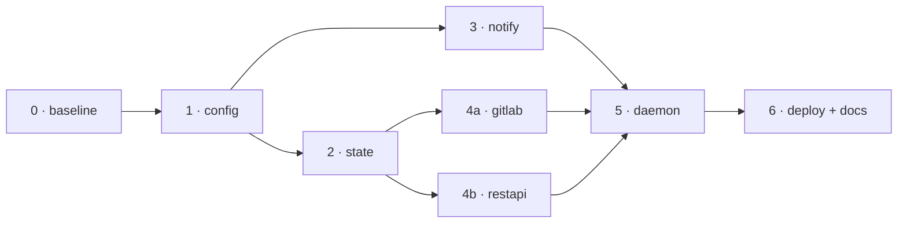

# Roadmap

polld exists as a complete first draft: every package, the tests, CI, the
systemd unit, and the ADRs landed in one pass and have never been compiled
or run against a real desktop. This roadmap turns that draft into a v1 by
**hardening it layer by layer**, each stage built by one agent and attacked
by another before it merges.

The stage order follows the package dependency graph, so a stage only ever
builds on layers that already passed their gate:



Stages on the same column (2 ∥ 3, 4a ∥ 4b) touch disjoint files and may run
in parallel.

## Open decisions

These change scope. Until answered, the roadmap assumes the default in
brackets; revisit the affected stage when one is decided.

| # | Question | Default assumed | Affects |
| --- | --- | --- | --- |
| D1 | Has CI ever run green on GitHub? | No — Stage 0 establishes it | 0 |
| D2 | Has polld ever run on a real desktop? | No | 3, 6 |
| D3 | v1 sources: GitLab + REST only, or more (GitHub, Jira, …)? | GitLab + REST only | post-v1 |
| D4 | Config reload on SIGHUP in v1? | No | post-v1 |
| D5 | Clickable notifications (spec *actions*) in v1? | No — body link only (ADR 0003) | post-v1 |
| D6 | Audience: personal tool or others install it? | Personal; release binaries are a nice-to-have | 6 |
| D7 | GitLab MR default scope: everything visible, or assigned/review-requested? | Change default to `assigned_to_me` + `reviewer_id=me`; `scope: all` stays opt-in | 4a |

## How a stage runs

Every stage follows the same loop. The prompts are in
[Agent prompts](#agent-prompts) below.

1. **Builder** works in its own git worktree on branch `stage/<n>-<name>`.
   It writes failing tests for each item in the stage's scope *first*, commits
   them, then makes them pass. Refactors and behavior changes go in separate
   commits ([CONTRIBUTING.md](../CONTRIBUTING.md)).
2. **Adversary** reviews the builder's branch with no write access to
   production code. It gets the stage spec and the diff — not the builder's
   reasoning. Its output is a list of findings, each backed by a failing test
   committed under `*_adversary_test.go` on a review branch, or a concrete
   failure scenario where a test is impossible.
3. **Builder, round 2** fixes every finding or rejects it in writing (why the
   behavior is correct). Up to two adversary rounds; anything still open
   after round 2 goes to the human.
4. **Gate** — the stage merges to `main` only when all of these hold:
   - `make all` and `make lint` pass; CI is green on the branch.
   - Every scope item has a test that failed before the change.
   - Every adversary finding is fixed (its test passes and is kept) or
     rejected with a reason the human accepted.
   - Docs/ADRs touched by the change still match the code.
   - The human signs off on the PR.

Adversary tests that expose a real bug stay in the suite (renamed into the
normal `*_test.go` once fixed); rejected ones are deleted.

## Stages

### Stage 0 — Baseline

Nothing else is trustworthy until the draft builds.

- [ ] Install the Go toolchain matching `go.mod`; `go build ./...`,
      `go vet ./...`, `go test -race ./...` pass — fix whatever doesn't.
- [ ] `golangci-lint run` passes with the committed config.
- [ ] Build with `CGO_ENABLED=0` in the Makefile and CI; add a CI check that
      the binary is statically linked (`file bin/polld` / `ldd` fails).
- [ ] Pin tool versions: golangci-lint, govulncheck (no `@latest`); pin
      GitHub Actions by commit SHA.
- [ ] Add a CI `build` job that produces the binary and runs
      `polld -version` and `polld -check-config` on the example config.

**Done when:** CI is green on `main` from a clean clone.

### Stage 1 — config

- [ ] Strict decoding: unknown keys at the root, in `notifications`, and in
      adapter options are errors (`yaml.Decoder.KnownFields`, and adapters
      reject leftovers from `Options`).
- [ ] `${VAR}` expansion fails on unset variables, naming the source and
      variable; bare `$VAR` is no longer expanded (replace `os.ExpandEnv`
      with a `${…}`-only expander). Decide and document whether `url` is
      expanded too.
- [ ] Validate global `poll_interval` (> 0) and enforce a minimum interval
      (e.g. 10s) for all intervals.
- [ ] `-check-config` constructs every adapter (`source.New`) so per-type
      errors — missing token, missing `watch`, bad mapping — are reported.
- [ ] Warn (or refuse, per config flag) when a source sends credentials over
      plain `http://`.
- [ ] Fix the `IntervalOr` doc comment.

**Done when:** every misconfiguration in the review is caught by
`-check-config` with a message naming the source and key.

### Stage 2 — state (parallel with 3)

- [ ] Prune must never drop an item the source still returns. Track
      `last_seen` per entry; prune only entries absent from recent polls, and
      cap by age as well as count. Regression test: a source returning 600
      items for 10 cycles produces zero notifications after seeding.
- [ ] Seed per *watch scope*, not per source: a new project or watcher added
      to an existing source seeds silently. The event carries a scope key
      (e.g. `Event.Scope`), or adapters expose their scopes.
- [ ] Garbage-collect state for sources no longer in the config (on start).
- [ ] fsync the directory after the atomic rename.
- [ ] State file schema gets a `version` field; unknown versions are
      treated like corruption (moved aside).

**Done when:** no growth or prune pattern can cause repeated notifications
for an unchanged item.

### Stage 3 — notify (parallel with 2)

- [ ] D-Bus backend honors per-notification urgency (the failure alert must
      arrive as critical). Test the hint map directly.
- [ ] Reconnect to the session bus when a call fails with a disconnected
      connection; retry once.
- [ ] `auto` falls back to `notify-send` per notification when D-Bus
      delivery fails, not only at startup.
- [ ] Query `GetCapabilities`; send markup only if the server advertises
      `body-markup`, and the link anchor only with `body-hyperlinks` —
      otherwise plain text with the URL on its own line.
- [ ] Only `http(s)` links are rendered.
- [ ] Integration test in CI under `dbus-run-session` with a fake
      `org.freedesktop.Notifications` server that records calls.

**Done when:** both backends are covered by tests that exercise the real
protocol or command line, not only pure helpers.

### Stage 4a — gitlab adapter (parallel with 4b)

- [ ] Partial failure is explicit: `Poll` returns the events it got *and*
      a per-scope error, and the daemon contract (Stage 5) consumes both.
- [ ] Pagination: follow `X-Next-Page` until reaching items already seen
      or a page cap; or use `updated_after` / `after` windows.
- [ ] MR default scope per D7; `scope: all` opt-in with a doc warning.
- [ ] MR update notifications say what changed when cheaply knowable
      (state transition, new commits via `sha`), otherwise "updated".
- [ ] Respect `429` and `Retry-After`.
- [ ] Note events (`target_type: Note`/`DiffNote`) link to the noteable,
      not the project root.

**Done when:** a busy project and a 404 project in the same source behave
correctly and visibly.

### Stage 4b — restapi adapter (parallel with 4a)

- [ ] `items` path not resolving to an array, invalid JSON, and a body
      exceeding the size limit are **errors**, not zero events.
- [ ] Configurable body limit; truncation detected.
- [ ] Optional pagination (`next` link path) — or explicitly out of scope
      and documented.
- [ ] Item missing `id` is still skipped, but counted and logged at debug.
- [ ] URL in errors and notifications has the query string redacted.
- [ ] Respect `429` and `Retry-After`.

**Done when:** every way a REST source can be misconfigured surfaces through
the health alert.

### Stage 5 — daemon

- [ ] Consume partial results: deliver the events from healthy scopes,
      count failures per scope, alert per failing scope.
- [ ] Deliver fresh events sorted by `OccurredAt` (stable, zero time last),
      not by assumed slice order.
- [ ] Startup jitter and exponential backoff on consecutive failures,
      capped at the interval × N.
- [ ] Save state after seeding, not only after the next notification.
- [ ] Shutdown: cancellation during a poll is not logged as a failure;
      in-flight notifications get a bounded grace period.
- [ ] `-once` returns the real underlying errors.
- [ ] Rename or fix `TestRunOnceConcurrentAndOrdered` so it asserts order.

**Done when:** the review's daemon findings each have a regression test.

### Stage 6 — deploy and docs

- [ ] Unit: `WantedBy=graphical-session.target`; verify `PrivateTmp=true`
      works in a user unit on Ubuntu 24.04 (drop it if it fails with
      `226/NAMESPACE`); add any user-unit-safe hardening.
- [ ] Makefile: `DESTDIR` honored consistently in install and uninstall.
- [ ] README truth pass: "at-least-once" (not exactly-once), static-binary
      claim backed by Stage 0, every config key documented and matching code.
- [ ] Clean up ADR wording (0001 "the user asked for", 0002 `${VAR}`
      sentence); new ADRs for decisions made in Stages 1–5 (strict config,
      prune policy, per-scope seeding, partial-failure semantics).
- [ ] Per D6: release job (goreleaser or plain `go build` + checksums)
      stamping `main.version`; CHANGELOG.
- [ ] Manual acceptance on a real GNOME session: install, seed, one MR
      update, one failing source, logout/login.

**Done when:** a new user can install from the README alone and everything
it says is true. Tag **v1.0.0**.

### Post-v1 backlog

Unscheduled; each needs an ADR before work starts.

- More adapters (D3).
- SIGHUP config reload (D4).
- Notification actions / click-to-open (D5).
- Per-source urgency, icon, and quiet hours.
- `polld status` (last poll, failures per source) via a state read.

## Agent prompts

Fill the `{…}` placeholders from the stage section. Give the adversary the
stage section and the diff, never the builder's transcript.

### Builder

```text
You are the builder for polld Stage {N} — {name}.

Repository: polld, a Go daemon (see README.md, CONTRIBUTING.md, docs/adr/).
Work only on branch stage/{N}-{name} in your own worktree. Touch only:
{files/packages in scope}. Do not modify other packages; if the stage needs
a change elsewhere, stop and report it.

Scope — every item must end with a test that failed before your change:
{paste the stage's checklist}

Rules:
- TDD: commit the failing tests first ("Add failing tests for …"), then the
  implementation. Refactors in their own commits, never mixed with behavior.
- Match the existing code: small functions, wrapped errors naming the
  source/key, handwritten fakes, httptest servers, table-driven tests.
- `make all` and `make lint` must pass before you finish. `-race` always.
- If a decision is a design choice (not a mechanic), write or update an ADR
  in docs/adr/ and say so.
- Update configs/config.example.yaml and README.md for any config change.

When done, report: what changed per scope item, the test names that prove
each, any scope item you could not complete and why, and any decision you
made that the human should review.
```

### Adversary

```text
You are the adversarial reviewer for polld Stage {N} — {name}. Your job is
to prove the builder's change wrong. You did not write it and owe it nothing.

Inputs: the stage spec below, and the diff of branch stage/{N}-{name}
against main. Read the surrounding code and ADRs as needed.

Stage spec:
{paste the stage's checklist and "Done when"}

You may NOT edit production code. You may add test files named
*_adversary_test.go on branch review/{N}-{name}-r{round}.

Hunt for:
- Spec items claimed done but not actually covered (test passes without the
  fix, asserts nothing meaningful, or tests a helper not the real path).
- Edge cases: empty/huge/malformed input, unset env, zero/negative values,
  clock skew, restart mid-operation, concurrent pollers, ctx cancellation.
- Races (`go test -race -count=20`), goroutine leaks, unbounded growth.
- Regressions in behavior outside the stage's scope.
- Docs, ADRs, example config, or comments that no longer match the code.
- Anything that would make the user miss a notification or get duplicates.

For each finding give: severity (blocker / major / minor), file:line, a
concrete failure scenario (inputs → wrong result), and the failing test that
demonstrates it — or why a test is impossible. Do not report style nits or
speculation without a scenario. If you find nothing, say so plainly and
list what you tried.
```

### Builder, round 2

```text
The adversary reviewed your Stage {N} change. Findings and their tests are
on branch review/{N}-{name}-r{round}:
{paste findings}

For each finding, either fix it (merge its test into your branch, make it
pass, keep the test) or reject it with a specific reason the behavior is
correct. Do not weaken or delete an adversary test to make it pass. Same
rules as before: `make all`, `make lint`, separate refactor commits.
Report per finding: fixed (commit) or rejected (reason).
```
